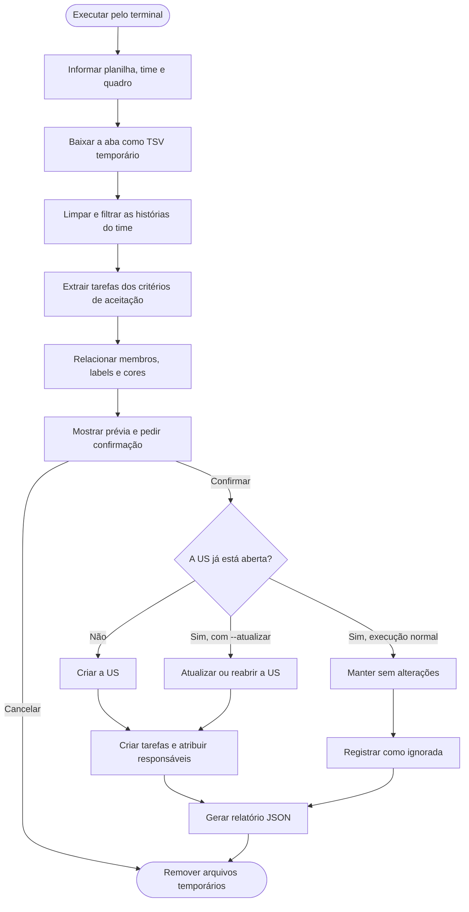

# Automação de Sprint do Trello — PET-TECH SUS

Como Scrum Master do projeto PET-TECH SUS da Universidade Federal de Alfenas
(UNIFAL-MG), criei esta ferramenta para agilizar o trabalho manual de transferir
histórias de usuário e suas tarefas de uma planilha de planejamento para um
quadro do Trello.

A aplicação é executada pelo terminal. Ela recebe o link da planilha, o número
do time e o link do quadro; depois filtra as histórias daquele time, extrai as
tarefas, associa membros e labels e monta os cards nas listas correspondentes.

> [!IMPORTANT]
> Este projeto foi desenvolvido especificamente para a planilha de planejamento
> utilizada pelo PET-TECH SUS da UNIFAL-MG. Ele depende dos nomes das colunas,
> dos padrões de escrita das tarefas, das regras de responsáveis, das cores e da
> organização dos quadros desse projeto. Para utilizar outra planilha ou outro
> processo Scrum, essas regras podem precisar ser adaptadas.

## O que a ferramenta faz

- baixa temporariamente uma aba do Google Sheets em TSV;
- localiza e limpa a tabela de histórias;
- filtra as histórias com estimativa maior que zero para o time escolhido;
- extrai as possíveis tarefas descritas nos critérios de aceitação;
- identifica os responsáveis configurados para o time;
- cria labels de US e TUS seguindo o padrão de cores do projeto;
- cria histórias em `User Stories Priorizadas`;
- cria tarefas em `Tarefas Planejadas`;
- evita duplicar cards que já estejam abertos;
- permite atualizar ou reabrir cards com `--atualizar`;
- repete requisições automaticamente quando a API do Trello limita o acesso;
- gera um relatório JSON ao final da execução.

Os arquivos TSV existem apenas em uma pasta temporária do sistema e são
apagados automaticamente ao terminar ou cancelar a execução.



## Requisitos

- Python 3.10 ou mais recente;
- acesso de leitura à planilha do Google Sheets;
- chave e token da API do Trello;
- permissão para criar e editar cards no quadro escolhido;
- as listas `User Stories Priorizadas` e `Tarefas Planejadas` no quadro.

O nome da primeira lista pode possuir um complemento, como
`User Stories Priorizadas - Do PB`.

## Instalação

Clone ou baixe o projeto e entre em sua pasta:

```bash
cd automacao_trello_original
```

Crie e ative um ambiente virtual:

```bash
python3 -m venv venv
source venv/bin/activate
```

No Windows, a ativação pode ser feita com:

```powershell
venv\Scripts\activate
```

Instale as dependências:

```bash
pip install -r requirements.txt
```

## Configuração do Trello

Copie o modelo das variáveis de ambiente:

```bash
cp .env.example .env
```

Preencha o arquivo `.env` local:

```dotenv
TRELLO_API_KEY=sua_chave
TRELLO_TOKEN=seu_token
```

Nunca publique o arquivo `.env`.

## Configuração dos membros

Nomes, usernames, apelidos e IDs dos membros são dados locais e não ficam no
código-fonte. Crie sua configuração a partir do exemplo:

```bash
cp config/membros.example.json config/membros.json
```

Cada item deve seguir este formato:

```json
{
    "nome": "Nome completo",
    "username": "usuario_no_trello",
    "id": "id_do_membro_no_trello",
    "apelidos": ["nome usado na planilha"]
}
```

Para consultar os membros e seus IDs diretamente no quadro:

```bash
python3 -m scripts.listar_membros
```

O arquivo `config/membros.json` é ignorado pelo Git.

## Como executar

Execução normal:

```bash
python3 main.py
```

O programa perguntará:

1. link da aba da planilha;
2. número do time;
3. link do quadro do Trello.

Antes de modificar o quadro, será mostrada uma prévia e solicitada uma
confirmação.

Para atualizar cards existentes, incluindo cards arquivados:

```bash
python3 main.py --atualizar
```

Na execução normal, cards abertos são mantidos sem alterações. Cards arquivados
não impedem a criação dos cards da nova sprint.

## Relatórios

O resultado é salvo em:

```text
relatorios/relatorio_trello_time_N.json
```

O relatório informa histórias e tarefas criadas, atualizadas, ignoradas e erros
encontrados. Esses arquivos também são ignorados pelo Git porque podem conter
informações internas do projeto.

## Organização do código

| Arquivo | Responsabilidade |
| --- | --- |
| `main.py` | Ponto de entrada da aplicação |
| `automacao_trello/cli.py` | Fluxo do terminal, prévia e relatório |
| `automacao_trello/configuracao.py` | Caminhos, cores e leitura da configuração local |
| `automacao_trello/planilha.py` | Download temporário, limpeza e filtro do TSV |
| `automacao_trello/tarefas.py` | Extração das tarefas dos critérios de aceitação |
| `automacao_trello/membros.py` | Identificação dos responsáveis |
| `automacao_trello/preparacao.py` | Cores, labels e preparação dos dados |
| `automacao_trello/trello_api.py` | Comunicação com a API do Trello |
| `automacao_trello/quadro.py` | Criação e atualização dos cards |
| `automacao_trello/texto.py` | Normalização e limpeza de textos |
| `config/membros.example.json` | Modelo publicável da configuração de membros |
| `config/membros.json` | Configuração local real, ignorada pelo Git |
| `scripts/listar_membros.py` | Consulta auxiliar dos membros de um quadro |
| `tests/test_regras.py` | Testes automatizados das principais regras |
| `.env.example` | Modelo das variáveis de ambiente |
| `requirements.txt` | Dependências Python |
| `LICENSE` | Termos da Licença MIT |

## Licença

Este projeto é distribuído sob a [Licença MIT](LICENSE).
